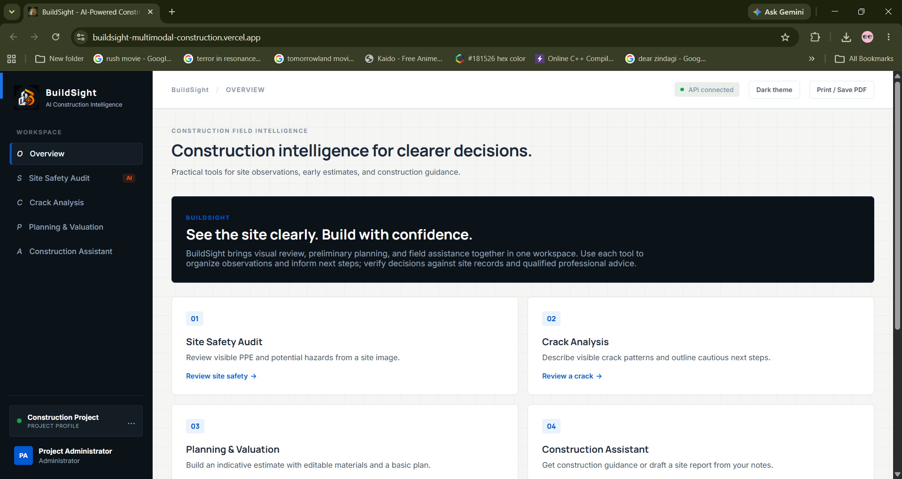
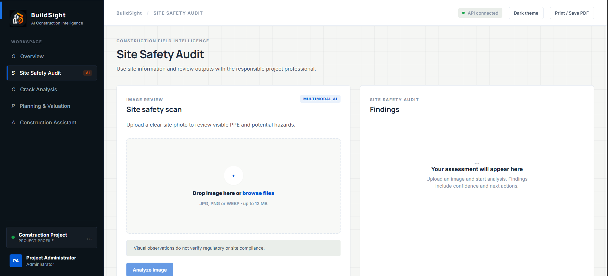
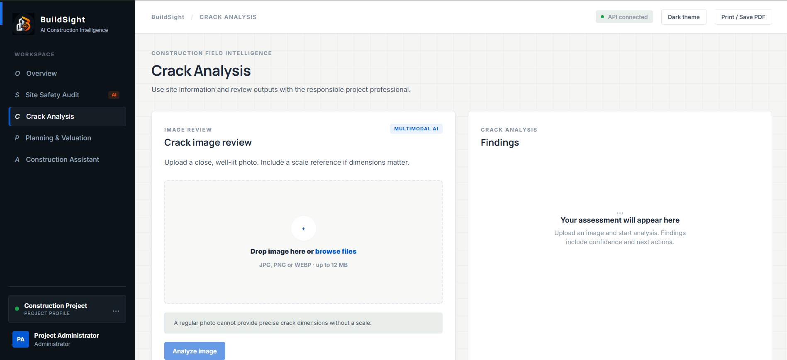
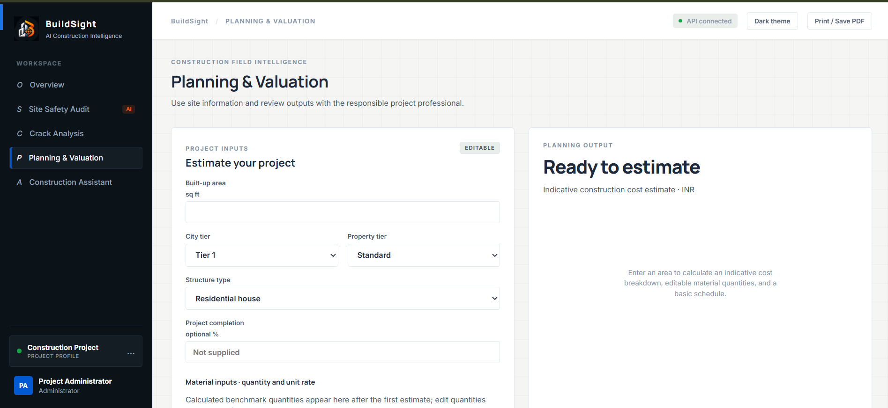
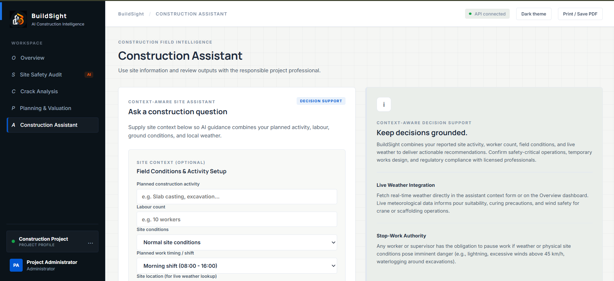

<div align="center">
  

# BuildSight · SITE INSIGHTS

**AI-Powered Construction Intelligence**

[](https://react.dev/)
[](https://vite.dev/)
[](https://fastapi.tiangolo.com/)
[](https://www.python.org/)
[](https://ai.google.dev/)

</div>

<br />

BuildSight brings visual site observations, preliminary construction estimates, weather context, and practical construction guidance into one workspace. Built with **React + Vite** and **FastAPI + Python**, it uses Google Gemini for supported AI-powered workflows.

---

## 🚀 Live Demo

- **Frontend:** [BuildSight on Vercel](https://buildsight-multimodal-construction.vercel.app/)
- **Backend API:** [BuildSight on Render](https://buildsight-multimodal-construction.onrender.com)
- **API health check:** [/api/health](https://buildsight-multimodal-construction.onrender.com/api/health)
- **Interactive API docs:** [/docs](https://buildsight-multimodal-construction.onrender.com/docs)

---

## ✨ Key Features

### 🦺 Site Safety Audit

- Uses Gemini multimodal image analysis to identify visible site-safety concerns.
- Validates provider results against expected response structures.
- Reports AI analysis as unavailable when the required API configuration is missing, rather than inventing results.

### 🧱 Crack Analysis

- Provides AI-assisted descriptions of visible crack patterns and cautious next steps.
- Does not infer reliable crack dimensions from ordinary photos without a suitable scale.

### 📐 Planning & Valuation

- Generates indicative INR construction estimates from inputs such as area, location tier, property tier, and structure type.
- Includes editable material quantities, cost breakdowns, schedules, and resource plans.

### 🤖 Construction Assistant

- Offers construction guidance and a daily-report workflow.
- Labels offline guidance appropriately; Gemini-powered responses require a configured backend API key.

### 🌦️ Weather Insights

- Uses Open-Meteo geocoding, current conditions, and a three-day forecast.
- Supports a user-entered location or coordinates and reports unavailable data when a location or provider cannot be resolved.

### 📄 Reports & Usability

- Supports structured safety/crack assessment exports and assistant report copying/export.
- Includes browser printing and a saved light/dark theme preference.

### 🔐 API Safeguards

- Configurable CORS origins and validated Pydantic response models.
- Keeps the Gemini API key on the backend rather than exposing it to browser code.

---

## 📸 Screenshots

|                                   Overview                                   |                                  Site Safety Audit                                   |
| :--------------------------------------------------------------------------: | :----------------------------------------------------------------------------------: |
|  |  |

|                                 Crack Analysis                                 |                                    Planning & Valuation                                    |
| :----------------------------------------------------------------------------: | :----------------------------------------------------------------------------------------: |
|  |  |

|                                     Construction Assistant                                     |
| :--------------------------------------------------------------------------------------------: |
|  |

---

## 🛠️ Technology Stack

**Frontend**

- React
- Vite
- Axios
- CSS

**Backend**

- Python
- FastAPI
- Pydantic
- Uvicorn

**AI & External Data**

- Google Gemini API for optional image analysis and assistant features
- Open-Meteo for weather and geocoding data

---

## ⚙️ Getting Started

### Prerequisites

Install the following before running BuildSight locally:

- [Python 3.12](https://www.python.org/downloads/) recommended for the deployed backend environment
- [Node.js and npm](https://nodejs.org/)
- [Git](https://git-scm.com/)
- Optional: a [Google AI Studio API key](https://aistudio.google.com/) for Gemini-powered features

### 1. Clone the Repository

```bash
git clone https://github.com/tusharRaghuwanshi43/buildsight-multimodal-construction-intelligence.git
cd buildsight-multimodal-construction-intelligence
```

### 2. Configure and Start the Backend

Open a terminal at the repository root:

```powershell
cd backend
```

Create and activate a virtual environment on Windows PowerShell:

```powershell
py -3.12 -m venv .venv
.\.venv\Scripts\Activate.ps1
pip install -r requirements.txt
```

If your repository includes a `.env.example`, copy it to `.env` and edit it locally:

```powershell
Copy-Item .env.example .env
```

Set `GEMINI_API_KEY` in `backend/.env` if you want Gemini-powered features. Keep this key backend-only and never commit `.env`.

Start the API:

```powershell
uvicorn main:app --reload --port 8000
```

- **Backend:** `http://localhost:8000`
- **Health check:** [http://localhost:8000/api/health](http://localhost:8000/api/health)
- **Interactive API docs:** [http://localhost:8000/docs](http://localhost:8000/docs)

### 3. Configure and Start the Frontend

Open a second terminal at the repository root:

```powershell
cd frontend
npm install
```

Create `frontend/.env` with the local backend URL:

```env
VITE_API_URL=http://localhost:8000
```

Start the Vite development server:

```powershell
npm run dev
```

Open [http://localhost:5173](http://localhost:5173).

Vite environment variables are read when the dev server starts. Restart it after changing `frontend/.env`.

---

## 🧪 Tests & Production Build

Run backend tests:

```powershell
cd backend
python -m pytest
```

Build the frontend:

```powershell
cd frontend
npm run build
```

---

## ☁️ Deployment

### Backend — Render

Configure the Render web service with these settings:

- **Root Directory:** `backend`
- **Build Command:** `pip install -r requirements.txt`
- **Start Command:** `uvicorn main:app --host 0.0.0.0 --port $PORT`
- **Python version:** use `3.12` via a `backend/.python-version` file if your dependencies do not support the default runtime.

Add `GEMINI_API_KEY` and, optionally, `GEMINI_MODEL` in Render's environment variables. Configure `CORS_ORIGINS` to include the exact deployed frontend origin, with no trailing slash:

```text
https://buildsight-multimodal-construction.vercel.app
```

Do not commit `.env` files or expose the Gemini API key in frontend environment variables.

### Frontend — Vercel

Deploy the `frontend` directory as a Vite application:

- **Root Directory:** `frontend`
- **Build Command:** `npm run build`
- **Output Directory:** `dist`
- **Environment Variable:** `VITE_API_URL`

Set `VITE_API_URL` to the deployed backend URL:

```text
https://buildsight-multimodal-construction.onrender.com
```

`VITE_` variables are embedded in client-side code, so only use this prefix for values that are safe to make public, such as the backend URL. Never store API keys or secrets in `VITE_` variables. Redeploy the frontend after changing environment variables.

---

## 📂 Project Structure

```text
buildsight-multimodal-construction-intelligence/
├── backend/
│   ├── main.py
│   ├── requirements.txt
│   └── .python-version
├── frontend/
│   ├── public/
│   ├── src/
│   │   ├── assets/
│   │   ├── App.jsx
│   │   └── App.css
│   ├── .env
│   └── package.json
└── README.md
```

This is a simplified overview; the exact files and folders may vary as the project evolves.

---

## 🤝 Contributing

Contributions and suggestions are welcome.

1. Fork the repository.
2. Create a feature branch: `git checkout -b feature/your-feature`
3. Commit your changes: `git commit -m "Add your feature"`
4. Push the branch: `git push origin feature/your-feature`
5. Open a Pull Request describing your changes.

Please test changes locally and avoid committing credentials, `.env` files, virtual environments, `node_modules`, or build output.

---

## ⚠️ Safety & Estimation Disclaimer

BuildSight is an informational decision-support tool, not a substitute for certified engineering judgment, professional safety inspections, or applicable local requirements. AI image observations may be incomplete or incorrect and do not certify PPE compliance, structural integrity, or code compliance. Crack dimensions cannot be reliably measured from ordinary photos without an appropriate scale and assessment method. Cost and schedule outputs are preliminary estimates, not professional valuations, quotations, or guarantees. Have qualified professionals review findings before using them in real projects.

---
